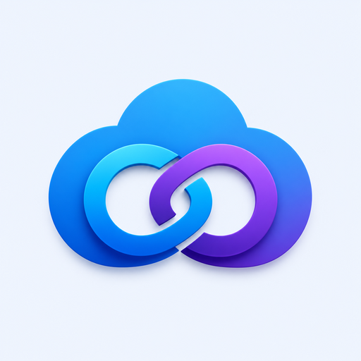
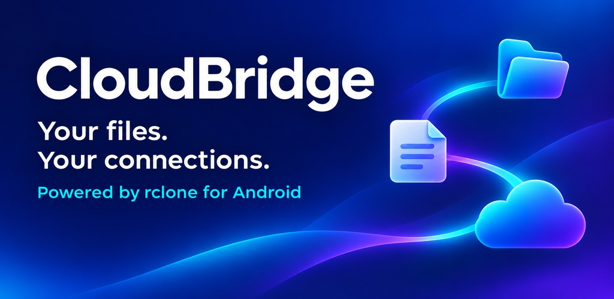
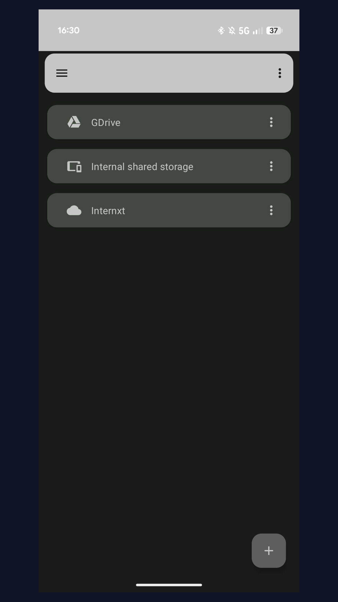
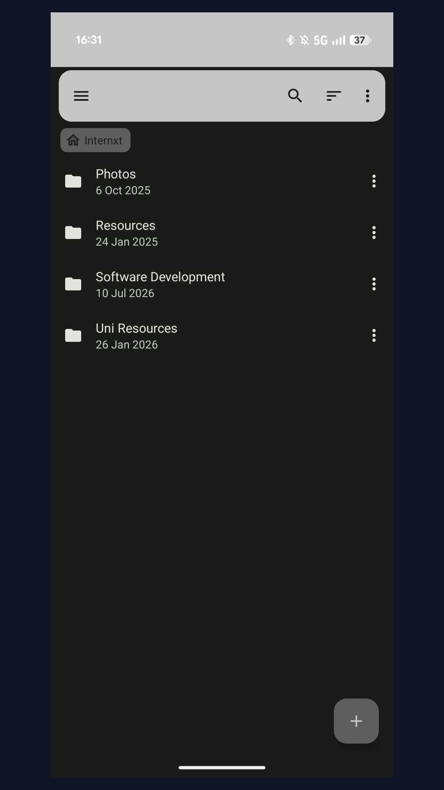
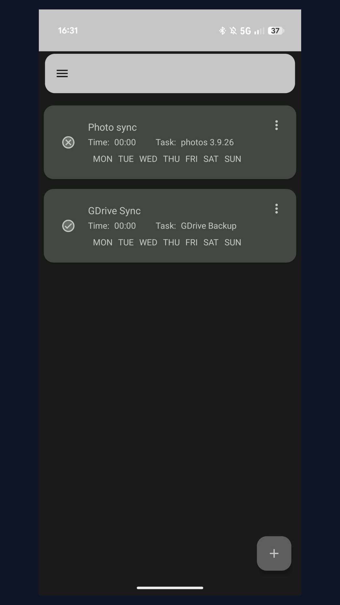
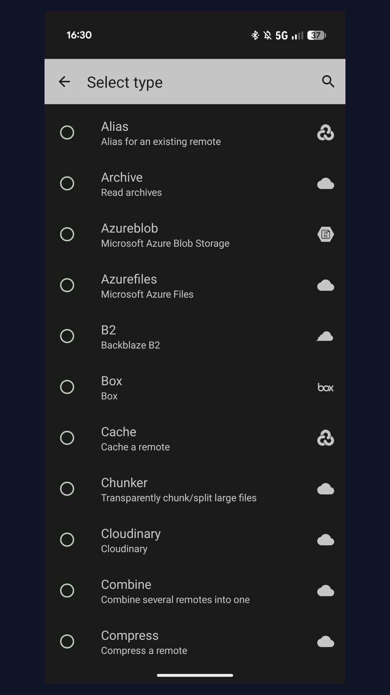
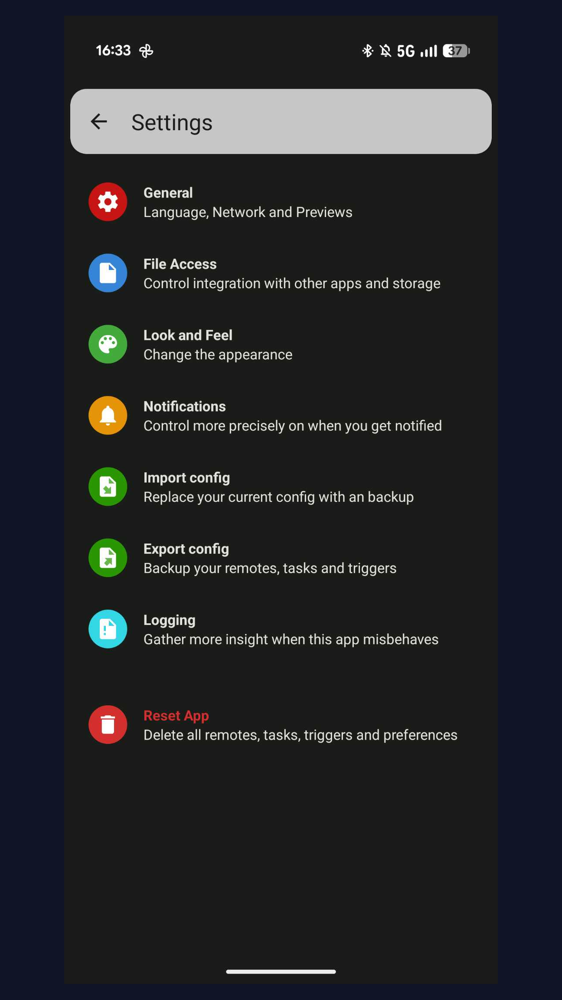

<p align="center">
  
</p>

<h1 align="center">CloudBridge</h1>

<p align="center"><strong>Your files. Your connections.</strong><br>A cloud file manager for Android, powered by rclone.</p>

<p align="center">
  <a href="https://github.com/thies2005/CloudBridge/releases/latest"><strong>Download stable</strong></a> ·
  <a href="https://github.com/thies2005/CloudBridge/releases/tag/development">Latest beta</a> ·
  <a href="https://thies2005.github.io/CloudBridge/">Documentation</a> ·
  <a href="https://github.com/thies2005/CloudBridge/issues">Report an issue</a>
</p>

<p align="center">
  <a href="LICENSE"></a>
  <a href="https://github.com/thies2005/CloudBridge/releases/latest"></a>
  <a href="https://github.com/thies2005/CloudBridge/actions/workflows/lint.yml"></a>
</p>



CloudBridge brings your cloud storage and local files together on your Android phone or tablet. Browse folders, transfer documents, stream media, and schedule recurring tasks from one app. Connect providers such as Internxt and Drime, or import an existing rclone configuration.

**Android 6.0+ · Open source · Material 3 · Light and dark themes**

## What you can do

| | Features |
|---|---|
| **Manage files** | Browse, view, upload, download, move, rename, and delete files and folders. |
| **Connect your storage** | Use rclone-compatible providers. Setup is available in the app for supported providers; others require a configuration import. |
| **Plan transfers** | Create copy or sync tasks and run them through scheduled triggers. |
| **Use encryption** | Configure rclone Crypt remotes to encrypt files before uploading them. |
| **Stream and serve** | Stream media or serve files and directories over HTTP, WebDAV, FTP, or DLNA. |
| **Work with Android** | Share files from other apps and use the Storage Access Framework for SD cards and USB storage. |

Provider capabilities depend on the selected service and configuration. CloudBridge connects to your storage; it does not provide cloud storage itself.

## A look inside

<table>
  <tr>
    <td align="center" width="33%"><br><strong>Your storage</strong></td>
    <td align="center" width="33%"><br><strong>Your files</strong></td>
    <td align="center" width="33%"><br><strong>Your schedule</strong></td>
  </tr>
</table>

<details>
<summary>More screenshots: providers and settings</summary>

<p>
  
  
</p>

</details>

## Get started

1. Install a signed APK from the [latest stable release](https://github.com/thies2005/CloudBridge/releases/latest).
2. Add a storage connection in CloudBridge, or import your existing rclone configuration. Use your own account for the chosen provider.
3. Open a connection to browse folders and transfer files. You can also share a file from another Android app to CloudBridge.
4. For recurring transfers, create a task and add a scheduled trigger.

Copy tasks transfer new or changed files. Sync tasks can also delete destination files to match the source; choose the direction and operation that fit your workflow.

### Choose your download

| APK variant | Suitable devices |
|---|---|
| **`arm64-v8a`** | Most modern Android phones and tablets |
| `armeabi-v7a` | Older 32-bit ARM devices |
| `x86_64` | 64-bit Intel/AMD devices and emulators |
| `x86` | 32-bit Intel/AMD devices and emulators |
| **`universal`** | All supported architectures; a larger download |

If you are unsure, choose `cloudbridge_v<version>-oss-universal-release.apk`. Download the APK to install on a device; Android App Bundles (`.aab`) are intended for distribution through Google Play.

The [automatic development build](https://github.com/thies2005/CloudBridge/releases/tag/development) follows `master` and may contain unfinished changes. Use the stable release for everyday use.

## Documentation and support

- [User and project documentation](https://thies2005.github.io/CloudBridge/)
- [How CloudBridge works](https://thies2005.github.io/CloudBridge/internals.html)
- [Privacy policy](https://thies2005.github.io/CloudBridge/privacy.html)
- [Bug reports and feature requests](https://github.com/thies2005/CloudBridge/issues)

Contributions and pull requests are welcome. When reporting a problem, include your app version, Android version, provider, and steps to reproduce it. Remove credentials and tokens from any logs you share.

## Build and contribute

CloudBridge contains the Android app, an rclone build module, and the SAF/WebDAV bridge library.

| Requirement | Version or location |
|---|---|
| Java | JDK 17 |
| Go | At least the version pinned in [gradle.properties](gradle.properties), currently 1.26.0 |
| Android SDK and NDK | Install the SDK and the NDK version pinned in [gradle.properties](gradle.properties) |
| SDK location | Set `sdk.dir` in `local.properties` or configure `ANDROID_HOME` |

```sh
# Build the open-source edition
./gradlew assembleOssDebug
./gradlew assembleOssRelease

# Run unit tests and lint
./gradlew testOssDebugUnitTest
./gradlew lint -x :rclone:buildAll
```

App builds trigger rclone cross-compilation. The first build downloads and caches the configured rclone source. Debug APKs are written to `app/build/outputs/apk/oss/debug/`; debug installs use the `.debug` application ID suffix.

For rclone upgrades, update `de.schuelken.cloudbridge.rCloneRef` in [gradle.properties](gradle.properties) and rebuild. Keep fetched sources under `rclone/cache/` untouched. See [AGENTS.md](AGENTS.md) for repository conventions and required checks.

### Start a task from another app

Create a task in CloudBridge and copy its ID from the task's three-dot menu. Automation apps can start it with this intent:

| Field | Value |
|---|---|
| Package | `de.schuelken.cloudbridge` |
| Class | `ca.pkay.rcloneexplorer.Services.SyncService` |
| Action | `START_TASK` |
| Integer extra | `task`: the task ID |
| Boolean extra | `notification`: `true` or `false` |

## Built on open source

CloudBridge is a fork of [Round-Sync](https://github.com/newhinton/Round-Sync) by **Felix Nüsse (newhinton)**, which is a fork of [RCX](https://github.com/x0b/rcx) by **x0b**, originally derived from [rcloneExplorer](https://github.com/patrykcoding/rcloneExplorer) by **Patryk Kaczmarkiewicz**. It is powered by [rclone](https://github.com/rclone/rclone), created by **Nick Craig-Wood and contributors**.

This fork adds maintenance, rclone updates, and provider integration work, including Internxt automatic token renewal and Drime support. Thank you to the upstream authors and contributors who made it possible.

<details>
<summary>Libraries and acknowledgements</summary>

- [rclone](https://github.com/rclone/rclone) - Calling this a library is an understatement. Without rclone, there would not be CloudBridge. See https://rclone.org/donate/ to support rclone.
- [Jetpack AndroidX](https://developer.android.com/license) - AppCompat, RecyclerView, ConstraintLayout, WorkManager, DataStore, Lifecycle, SplashScreen and more.
- [Material Components](https://github.com/material-components/material-components-android) - Material 3 widgets and theming.
- [Kotlin Coroutines](https://github.com/Kotlin/kotlinx.coroutines) and [kotlinx.serialization](https://github.com/Kotlin/kotlinx.serialization) - Async work and JSON serialization.
- [Floating Action Button SpeedDial](https://github.com/leinardi/FloatingActionButtonSpeedDial) - A Floating Action Button Speed Dial implementation for Android that follows the Material Design specification.
- [Glide](https://github.com/bumptech/glide) - An image loading and caching library for Android focused on smooth scrolling.
- [MarkdownJ](https://github.com/myabc/markdownj) - converts markdown into HTML.
- [OkHttp](https://github.com/square/okhttp) - HTTP client used for provider APIs and authentication.
- [Jackson](https://github.com/FasterXML/jackson-core) - JSON processing.
- [NanoHTTPD](https://github.com/NanoHttpd/NanoHttpd) - Embedded HTTP server used for serving files and the SAF/WebDAV bridge.
- [Recyclerview Animators](https://github.com/wasabeef/recyclerview-animators) - An Android Animation library which easily add itemanimator to RecyclerView items.
- [Toasty](https://github.com/GrenderG/Toasty) - The usual Toast, but with steroids.
- [AppIntro](https://github.com/AppIntro/AppIntro) - Onboarding introduction screens.
- [RFC 3339 Date Parser](https://github.com/x0b/rfc3339parser) - Timestamp parsing.
- [App Update Checker](https://github.com/Sharkaboi/AppUpdateChecker) - Checks GitHub for new app versions.
- [android-retrofuture / android-retrostreams](https://github.com/streamsupport/streamsupport) - Java 8+ streams and CompletableFuture backports.
- Icons from [Flaticon](https://www.flaticon.com) courtesy of [Smashicons](https://www.flaticon.com/authors/smashicons) and [Freepik](https://www.flaticon.com/authors/freepik)

</details>

## License

CloudBridge is released under the [GNU General Public License v3](LICENSE). Contributions are provided under the same license.

If you distribute a modified fork, please use a distinct name, app icon, and package ID, and preserve the upstream attribution to avoid confusion.
